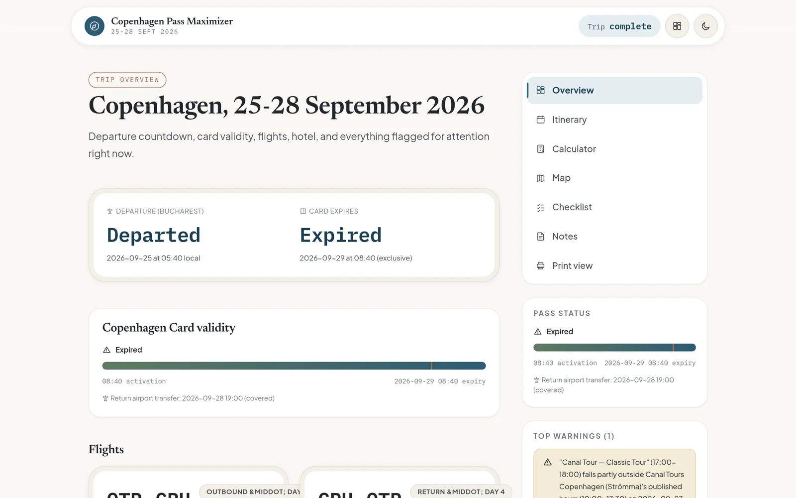
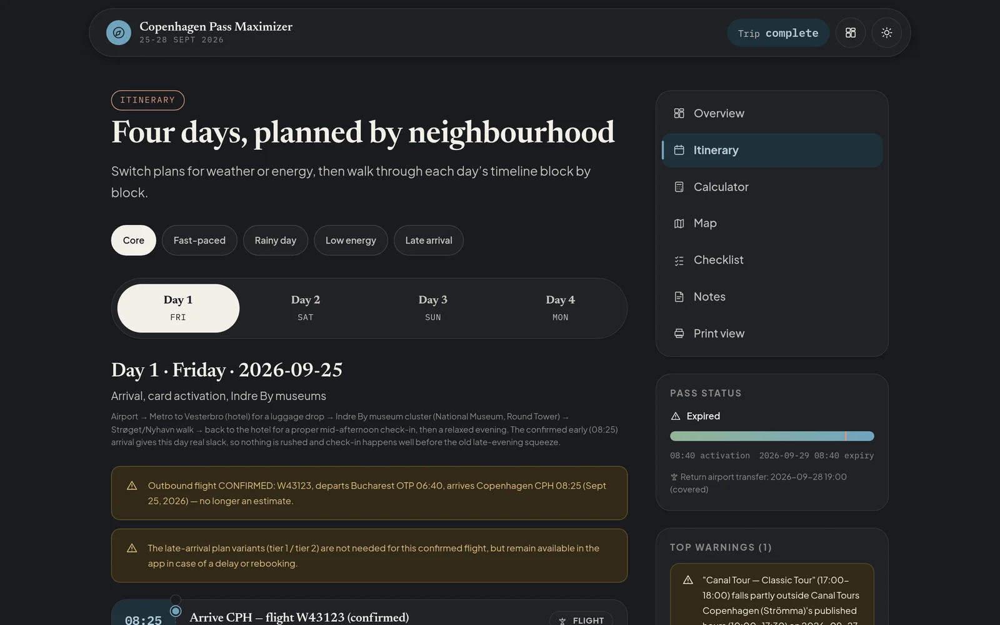
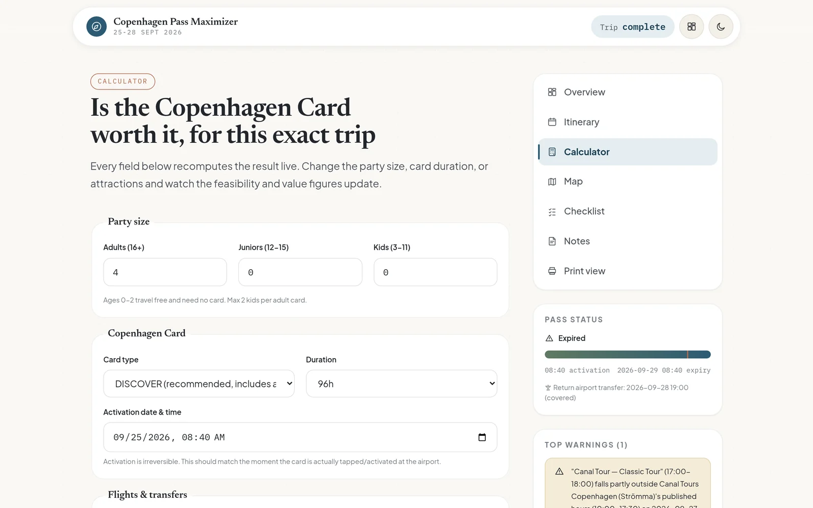
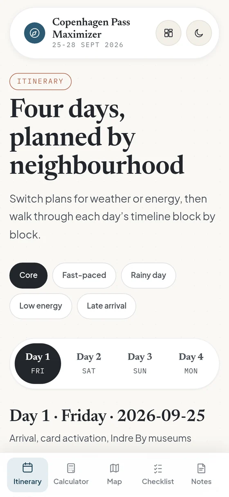
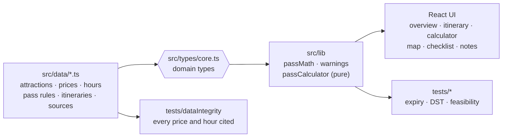

<div align="center">


<sub><a href="#-the-problem">The problem</a> &nbsp;·&nbsp; <a href="#-features">Features</a> &nbsp;·&nbsp; <a href="#-how-it-works">How it works</a> &nbsp;·&nbsp; <a href="#-run-it">Run it</a> &nbsp;·&nbsp; <a href="docs/DEVELOPMENT.md">Dev guide</a></sub>

</div>

<br/>

> Four adults, four days in Copenhagen (25–28 Sept 2026), one 96-hour Copenhagen Card each.
> The card only pays off if the plan respects opening hours, one-visit-per-attraction rules,
> transit times and the exact minute the card expires. This app turns that into typed data and pure functions,
> then shows the plan, the savings and every risk on one screen, offline.

<br/>



<table>
  <tr>
    <td width="68%"><br/></td>
    <td width="32%" valign="top"></td>
  </tr>
</table>

## ◆ &nbsp;The problem

City passes are sold on "save up to X%". Whether they actually save money depends on details nobody checks:
does the museum close at 16:00 or 17:00 in late September, does the airport train count if the journey *ends* after expiry,
is Tivoli even open. Every one of those facts is captured here with a source link and a verification status,
and the plan is rebuilt around them.

## ◆ &nbsp;Features

<table>
  <tr>
    <td width="33%" valign="top">
      <h4>🗓️ Five itineraries</h4>
      <p>Core, fast-paced, rainy-day, low-energy and late-arrival plans, switchable per day, each a timeline of blocks with fallbacks.</p>
    </td>
    <td width="33%" valign="top">
      <h4>🧮 Live value calculator</h4>
      <p>Change party size, card type, duration or activation time and watch feasibility and savings recompute instantly.</p>
    </td>
    <td width="33%" valign="top">
      <h4>⚠️ Warning engine</h4>
      <p>Flags visits outside opening hours, expiry edge cases, DST shifts and unverified facts, ranked by severity.</p>
    </td>
  </tr>
  <tr>
    <td width="33%" valign="top">
      <h4>📶 Offline-first PWA</h4>
      <p>Installable, service-worker cached, usable mid-trip on patchy roaming data.</p>
    </td>
    <td width="33%" valign="top">
      <h4>🗺️ Map, checklist, notes</h4>
      <p>Keyless map embed, packing and booking checklists, private notes in local storage, calendar (.ics) export and a print view.</p>
    </td>
    <td width="33%" valign="top">
      <h4>🔒 No backend</h4>
      <p>No accounts, analytics or API keys. A static build behind nginx with strict security headers.</p>
    </td>
  </tr>
</table>

## ◆ &nbsp;How it works



- **Data as code.** Every attraction, price, opening hour and rule is a typed constant with a source citation, so the compiler and the tests guard the research.
- **Pure core.** Pass expiry, feasibility and the warning engine are dependency-free functions with no I/O, covered by Vitest (expiry, exclusivity, DST, 72h vs 96h, data integrity).
- **Thin UI.** React components read the computed results; nothing in the UI re-derives business rules.

## ◆ &nbsp;Run it

```sh
npm install
npm run dev          # Vite dev server on :5173
npm test             # Vitest suite
npm run typecheck    # tsc --noEmit
docker compose up -d --build   # production build behind nginx on 127.0.0.1:8496
```

Updating the data, security notes, deployment and the dated research-verification record are in the
**[development guide](docs/DEVELOPMENT.md)**.

## ◆ &nbsp;Tech


<br/>

<div align="center">
<sub>Built by <a href="https://github.com/LikeMyCoffe"><b>Eduard-Florentin Enache</b></a> &nbsp;·&nbsp; Data · BI · AI product builder</sub>

</div>
